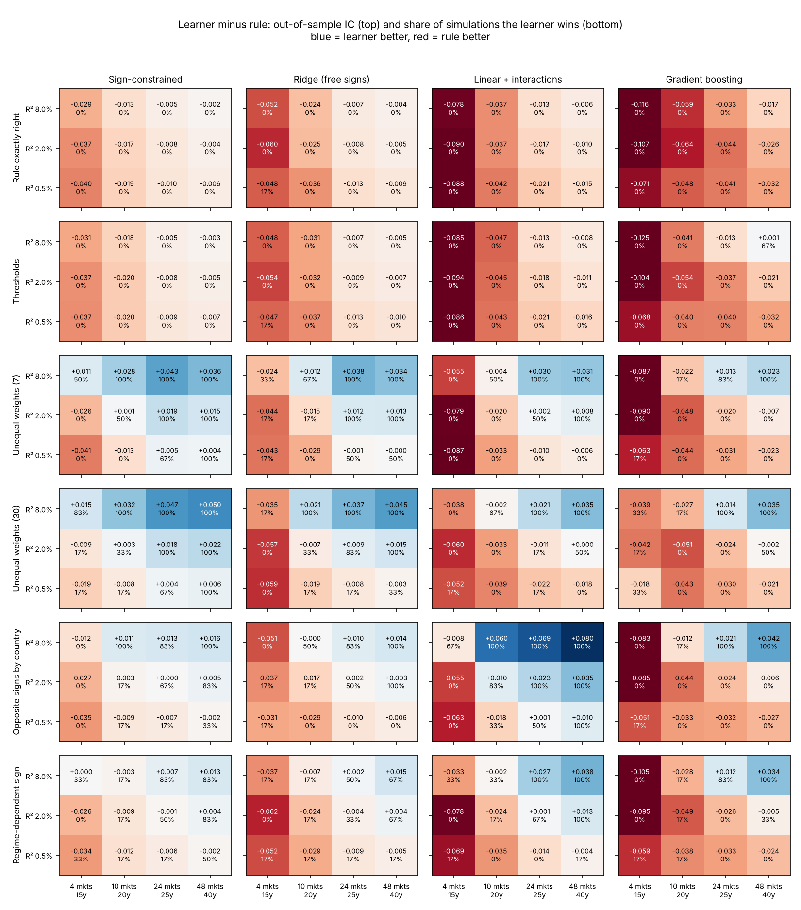
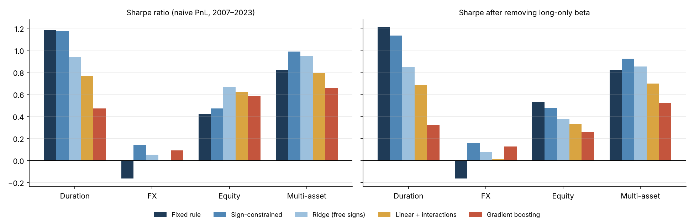

# When can machine learning beat a fixed rule?

**Simulation with known truth and a pre-registered test on JPMaQS duration, FX and equity returns**

Di Liu · November 2026

A theory-signed composite of macro indicators is hard to beat with machine learning. This project asks *when*
a learner should beat such a rule and whether it does on real data. It uses the
[macrosynergy](https://github.com/macrosynergy/macrosynergy) package and the public JPMaQS dataset on Kaggle.

## Result in brief

* **Simulation (432 panels where the truth is known).** Learners beat the rule only when the rule is
  mis-specified in a way a constrained model can represent: unequal weights, or signs that flip by country or
  regime. Even then they need about **24 markets × 25 years**, and the edge is about **+0.02 in out-of-sample IC**.
  Gradient boosting is the weakest learner throughout.
* **Real data (2007–2023), with the test fixed before the run.** Four learners against theory-signed rules in
  duration (24 markets), FX (23) and equity (16). **None of 16 comparisons passes**: the largest t-statistic
  against a rule is 1.51, against a Bonferroni threshold of 2.96.
* **Two traps that headline Sharpe ratios hide.** In FX the learners lead only because the rule loses money; no
  FX signal is significant. In equity the learners' higher Sharpe is mostly long-equity beta; after removing it,
  the rule is best (0.53 against 0.26–0.47).

**Takeaway:** structure beats flexibility. Let theory fix the signs and the data set the weights, test a learner
only for a specific, economically motivated interaction, and judge it on IC, sub-panel consistency and
beta-neutral performance rather than headline Sharpe.

## Part A: where each learner wins (simulation)



*Learner minus rule out-of-sample IC (top number) and share of simulated panels the learner wins (bottom).
Blue = learner better. The real data sit near the 24-market, R² 2% column.*

| Truth | Result |
|---|---|
| Rule exactly right | No learner wins on average in any cell |
| Thresholds | Linear rule captures most of the effect; boosting draws level only at 48 markets, R² 8% |
| Unequal weights | Sign-constrained learner wins 100% of panels from 24 markets at R² 2% (+0.019 IC) |
| Opposite signs by country | Linear + interactions wins 100% from 24 markets at R² 2% (+0.023 IC); boosting still loses |
| Regime-dependent sign | Same pattern, weaker |
| Any truth, 4 markets | The rule wins almost everywhere |

## Part B: real data, pre-registered



| | Rule | Sign-constrained | Ridge | Linear + int. | Boosting |
|---|---|---|---|---|---|
| Duration IC / Sharpe | **0.126 / 1.18** | 0.102 / 1.17 | 0.083 / 0.94 | 0.067 / 0.77 | 0.033 / 0.47 |
| FX IC / Sharpe | −0.003 / −0.17 | 0.008 / 0.14 | 0.001 / 0.05 | 0.013 / 0.00 | 0.012 / 0.09 |
| Equity IC / beta-neutral Sharpe | **0.085 / 0.53** | 0.061 / 0.47 | 0.047 / 0.37 | 0.046 / 0.33 | 0.038 / 0.26 |
| Multi-asset Sharpe (t vs rule) | 0.82 | 0.99 (0.76) | 0.95 (0.46) | 0.79 (−0.06) | 0.66 (−0.46) |

*IC = pooled monthly Pearson correlation with next-month returns. Naive PnLs at 10% vol, monthly rebalancing,
one-day slippage, gross of transaction costs.*

**Decision rule (written before the run):** a learner beats the rule only if its paired HAC t-statistic on daily
PnL differences is ≥ 2.96 (Bonferroni for 16 tests) **and** its gap is positive in both developed and emerging
sub-panels.

**Disclosed changes after the first run:** USD was missing from the learners that use FX carry (USD has no carry
series), so its carry was set to zero and everything re-run. A beta-neutral Sharpe was added as a diagnostic. The
decision rule was not changed.

## Methods

| Contender | What it does |
|---|---|
| Rule | Equal-weight average of theory-signed z-scores (no estimation) |
| Sign-constrained | Non-negative least squares / non-negative Ridge on theory-oriented features |
| Ridge | Ridge on all features, signs free |
| Linear + interactions | Ridge plus feature × context interactions (emerging market, high inflation) |
| Gradient boosting | Shallow boosted trees on features plus context |

* **Features (nine, for every asset class):** inflation and growth relative to benchmarks, private credit growth,
  real 5y and 2y swap yields, the real slope and FX carry. All are sequential, point-in-time z-scores.
* **Learning:** `macrosynergy.learning.SignalOptimizer`, re-selected quarterly with expanding panel
  cross-validation; no look-ahead.
* **Evaluation:** `NaivePnL`, `SignalReturnRelations`, HAC t-tests (statsmodels), beta-neutral Sharpe.

## Files

| File | Contents |
|---|---|
| `ml_vs_rules.ipynb` | Full analysis, executed with outputs (Part A simulation, Part B pre-registration, tests, results) |
| `ml_vs_rules_report.pdf` | 4-page write-up |
| `sim_results.csv` | Out-of-sample ICs for all 432 simulated panels |
| `figures/` | Figures used above |

## How to run

```bash
python -m venv .venv && source .venv/bin/activate
pip install -r requirements.txt
jupyter notebook ml_vs_rules.ipynb
```

**Data.** The notebook reads JPMaQS CSV files from `./data` if present; otherwise it downloads the public Kaggle
dataset [macrosynergy/fixed-income-returns-and-macro-trends](https://www.kaggle.com/datasets/macrosynergy/fixed-income-returns-and-macro-trends)
with `kagglehub` (a free Kaggle account and API token are needed). The data are not redistributed here.

**Runtime.** About 10 minutes on 2 cores (Part A about 7, Part B about 3). Set `N_SEEDS = 2` in the first cell for a
quick run; results then differ slightly from those reported.

## Limitations

Gross of transaction costs; one feature set per asset class; simulated features are Gaussian AR(1) series without
structural breaks; six simulated panels per cell; the Bonferroni threshold makes the real-data test conservative.

## Licence

Code and write-up: [MIT](LICENSE). The JPMaQS data are not included and remain subject to the
[Kaggle dataset](https://www.kaggle.com/datasets/macrosynergy/fixed-income-returns-and-macro-trends) terms.
